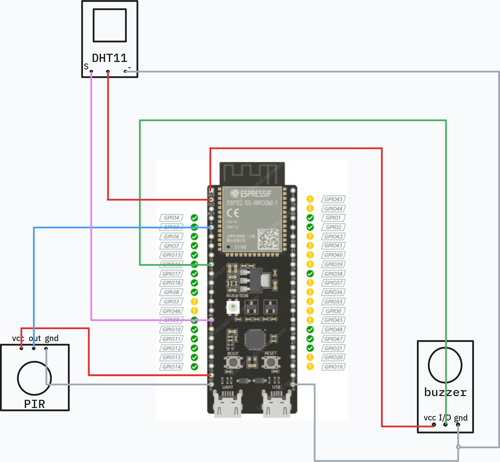

# iot-ac-control-device

## Prerequisites

Before building the project, make sure you have the following installed:

- **ESP-IDF v6.1** — Espressif IoT Development Framework.
- **Visual Studio Code** with the ESP-IDF extension (if using VS Code).
- **ESP32-S3 development board** connected to your computer via USB.

### Verify the ESP-IDF installation

To check your ESP-IDF version, run:

`idf.py --version`

If you are using a Linux distro, first activate the environment with:

`. $HOME/esp/esp-idf/export.sh`

## Build

1. In VS Code in ***detect*** field choose the USB port where your ESP32-S3 is attached (e.g. /dev/ttyACM0).
2. In the next field (default value is esp32) choose **esp32s3**, and when prompted, use **ESP32-S3 chip (via builtin USB/JTAG)** option
	 If using the CLI:
	 
	`idf.py set-target esp32s3`

3. Click on the **build icon** 🔧 to build the project
	 If using the CLI:
	 
   `idf.py build`
   
## Flash

1. Click the **flash icon** ⚡ in order to flash the firmware (the device has to be connected to your computer)
	 If using the CLI:
	 
   `idf.py -p /dev/ttyACM0 flash`
   
2. Monitor serial communication clicking on **monitor icon** 🖥️
	If using the CLI:
	
   `idf.py -p /dev/ttyACM0 monitor`

If you get OpenOCD server error make sure you're flashing via UART. Go to ESP-IDF extension; on the left panel under Advanced, choose Flash with UART.